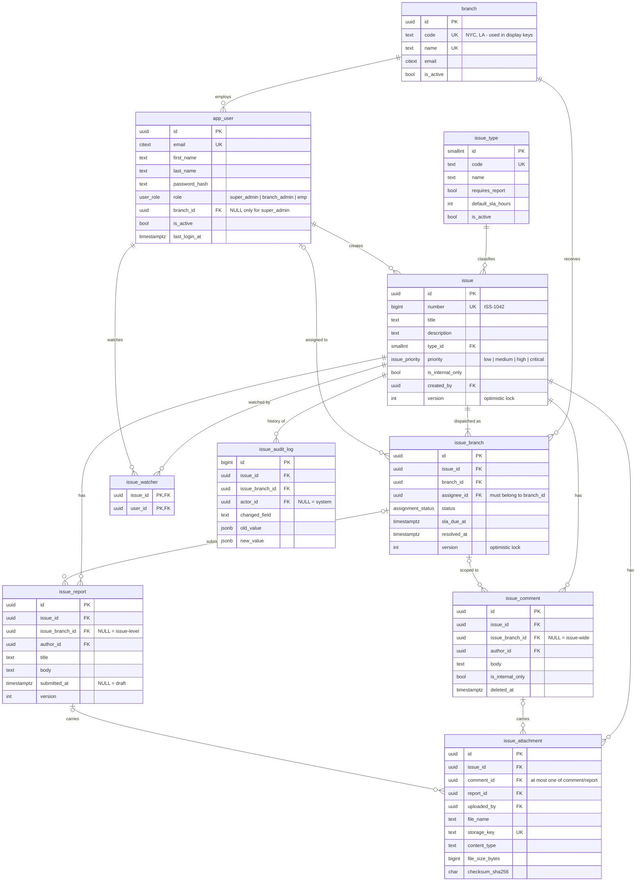

# Ticketing DB design — v0.0.2

PostgreSQL 14+. Full DDL in [schema.sql](schema.sql).

## Core idea

An **issue** describes *what* needs doing. It is dispatched to one or more
**branches**; each dispatch is an **issue_branch** row that carries *who*
(assignee), *where it stands* (status), and *by when* (sla_due_at) for that
branch. The issue's overall status is derived from its issue_branch rows.

## ER diagram

Every table except the lookup and the audit log also has `created_at` and
`updated_at`. A trigger maintains `updated_at`.

## What changed from v0.0.1

| Area | v0.0.1 | v0.0.2 |
|---|---|---|
| Multi-branch | `issue.id_branch`/`id_assignee` **and** `Issue-branch` **and** `Issue-User` | Only `issue_branch`, with assignee, status and SLA per branch |
| Users ↔ branch | Not linked | `app_user.branch_id`, required for everyone except super_admin |
| Status | `DONE, TODO, DELAYED` on issue | `open, in_progress, blocked, resolved, closed, cancelled` per branch. Overdue is computed |
| Deadline | `Deadline` + `sla_due_at` | `sla_due_at` only, per branch |
| Visibility | `issue.is_external`, `comment.is_internal_only` | `is_internal_only` on both |
| Type | Enum `<Report, ...>` | `issue_type` lookup table with `requires_report` and `default_sla_hours` |
| Report | `(id_issue, body, id_attachment)` | Full table: author, title, draft/submitted, versioned, per-branch, any number of attachments |
| Issue-User | Unclear | `issue_watcher` |
| Attachments | `storage_url`, issue only | `storage_key`, `content_type`, checksum. Attach to the issue, a comment or a report |
| Audit | TEXT values, mutable | `jsonb` values, branch-aware, append-only (trigger), nullable actor for system jobs |
| Naming | kebab-case, mixed `id_x` / `x_id` | snake_case, `x_id` everywhere |

## Integrity enforced by the database

These have all been tested against Postgres.

- **Non-super_admin users must have a branch**, and super_admins must not have one (`app_user_branch_by_role`).
- **Emails are unique regardless of case** (`citext`).
- **An assignee must belong to the branch they're assigned in.** A composite FK `(assignee_id, branch_id) → app_user(id, branch_id)` enforces this.
- **A branch can receive an issue only once** (`UNIQUE (issue_id, branch_id)`).
- **`resolved_at` is set exactly when the status is `resolved` or `closed`.**
- **Comments, reports and audit rows can't point at another issue's assignment.** Composite FKs on `(issue_branch_id, issue_id)` enforce this.
- **Attachments have at most one parent** (comment or report), and that parent must belong to the same issue.
- **The audit log is append-only.** UPDATE and DELETE raise an error.

## Derived state (views)

- **`issue_branch_overview`** adds `is_overdue`: past `sla_due_at` and still open, in_progress or blocked.
- **`issue_overview`** rolls the assignments up per issue: `branch_count`, `done_count`, `is_overdue` (any branch overdue), `next_sla_due_at`, and `overall_status`:

| overall_status | When |
|---|---|
| `undispatched` | No branches yet |
| `open` | Every branch is still `open` |
| `in_progress` | Any branch has moved past `open`, but not all are finished |
| `resolved` | Every branch is resolved, closed or cancelled |
| `closed` | Every branch is closed or cancelled |

## Access rules (enforced in the Rust API)

| Role | Issues visible | Can change |
|---|---|---|
| super_admin | All | Everything: create and dispatch issues, close, manage types, branches and users |
| branch_admin | Issues with an `issue_branch` row for their branch | Their branch's rows: assign, set status, edit SLA, submit reports, see internal comments |
| emp | Non-internal issues dispatched to their branch | Status of rows assigned to them, plus comments and reports on those rows |

- **`is_internal_only`** on an issue or comment hides it from `emp`. Admins always see it.
- **Scope every query by the caller's branch**, for example `WHERE ib.branch_id = $caller_branch`. Postgres RLS can be added later as a backstop.

## Workflow rules (enforced in the Rust API)

1. **Dispatch.** Creating `issue_branch` rows sets `sla_due_at`, defaulting to `now() + issue_type.default_sla_hours`.
2. **Optimistic locking.** Run `UPDATE ... SET ..., version = version + 1 WHERE id = $1 AND version = $2`. Zero rows updated means 409 Conflict.
3. **Status transitions** follow this graph:
   `open → in_progress ⇄ blocked → resolved → closed`, plus `resolved → in_progress` (reopen). Any non-terminal state can go to `cancelled`. Only the issue creator or an admin can `close`.
4. **Report-required types.** If `issue_type.requires_report`, a branch can't move to `resolved` until a submitted `issue_report` exists for its `issue_branch_id`.
5. **Audit in the same transaction.** Every change to status, assignee, priority, SLA or title writes an `issue_audit_log` row in the same transaction as the change.
6. **No hard deletes.**
   - Issues are cancelled or closed, never deleted.
   - Users are deactivated (`is_active = false`).
   - Comments are soft-deleted (`deleted_at`).
   - Removing a branch from an issue means cancelling its row.
7. **Attachments.** Upload to object storage first, then insert the row. Serve files through short-lived signed URLs generated from `storage_key`.

## Index plan

| Query | Index |
|---|---|
| Branch queue (`branch_id`, `status`) | `issue_branch_queue_idx` |
| My work | `issue_branch_assignee_idx` |
| SLA breach sweep | `issue_branch_sla_idx` (partial, active rows only) |
| Issue timeline | `issue_comment_issue_idx`, `issue_audit_log_issue_idx` |
| User activity | `issue_audit_log_actor_idx` |
| Recent issues | `issue_created_at_idx` |

## Out of scope / next

- **Sessions and refresh tokens**, if the API doesn't use stateless JWTs.
- **A notifications table**, with watchers and assignees as recipients.
- **Full-text search** on title, description and comments (a `tsvector` column plus a GIN index).
- **Tags or labels**, if `issue_type` turns out to be too coarse.
